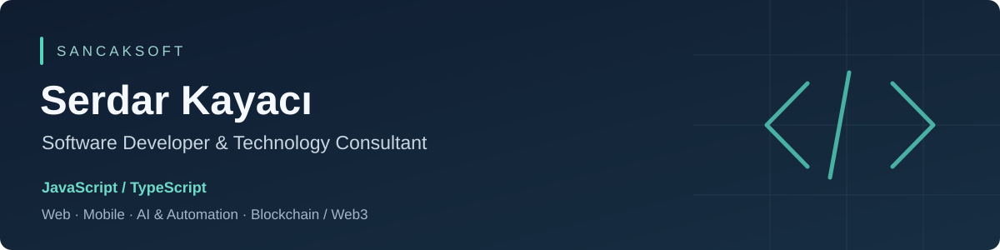

  

  <a href="https://sancaksoft.com">SancakSoft</a> &nbsp; · &nbsp;
  <a href="https://www.linkedin.com/in/serdar-kayac%C4%B1-129107167/">LinkedIn</a> &nbsp; · &nbsp;
  <a href="README.tr.md">Türkçe</a>

## About

I'm Serdar, a software developer and technology consultant at **SancakSoft**, based in Istanbul. I develop software for business needs and help teams make practical architecture and technology decisions.

My strongest stack is **JavaScript and TypeScript**, especially **Node.js, React and Next.js**. My work also covers mobile applications, AI integrations, automation, and blockchain / Web3.

I care about clear requirements, maintainable systems, security, and the total cost of building and operating software.

## Technical focus

| Area | Technologies and interests |
| --- | --- |
| Web & APIs | JavaScript, TypeScript, Node.js, React, Next.js, NestJS, Express |
| Data & infrastructure | PostgreSQL, Prisma, Redis, Docker |
| AI & automation | Knowledge assistants, RAG, semantic search, workflow and agent orchestration |
| Blockchain / Web3 | Wallet authentication, on-chain integrations, application architecture |

## Selected repositories

| Project | What to explore |
| --- | --- |
| [Athena](https://github.com/devSerdar/athena) | AI knowledge-assistant prototype: Gmail synchronization, semantic email search and source-linked answers. **NestJS · Next.js · PostgreSQL · pgvector** |
| [FundFlow](https://github.com/devSerdar/fundflow) | BSC crowdfunding prototype with a Next.js frontend, Express gateway, wallet-signature authentication and service scaffolds. **TypeScript · Next.js · Express · ethers** |
| [UlakPay](https://github.com/devSerdar/ulakpay) | Local wallet and QR-payment backend MVP exploring ledger entries, database transactions and idempotency. **TypeScript · Express · Prisma · PostgreSQL** |
| [Sosyal AI](https://github.com/devSerdar/sosyal-ai) | AI-agent orchestration prototype with routing, structured validation, memory and evaluation endpoints. **Python · FastAPI · Pydantic · Redis** |

These repositories include prototypes and work in progress. Each project's README describes its scope and setup; UlakPay uses mock deposits and transfers rather than real payment integrations.

## Work with me

For software development, integrations or a technical review, visit [sancaksoft.com](https://sancaksoft.com) or connect on [LinkedIn](https://www.linkedin.com/in/serdar-kayac%C4%B1-129107167/).
